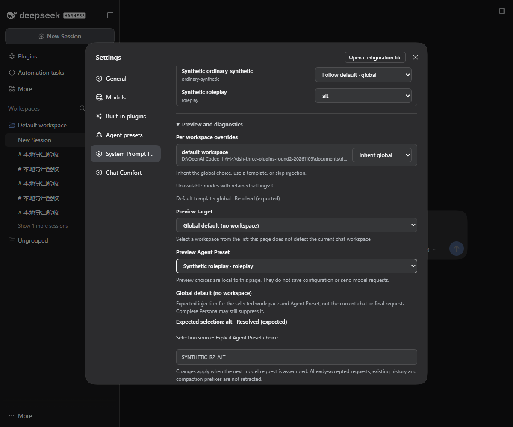
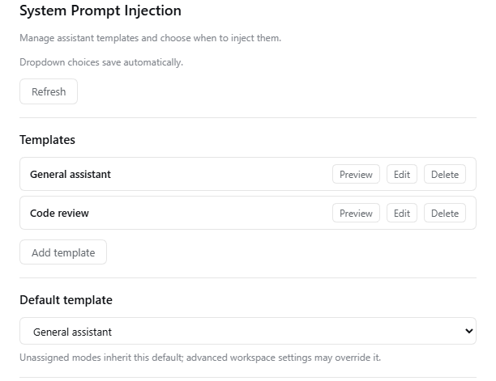
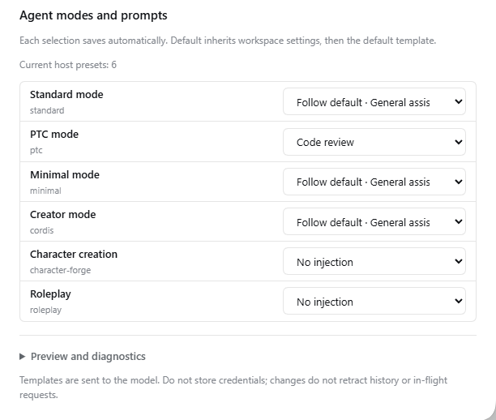

# System Prompt Injection · DSH Prompt Inject

**Original Author:** [H1a3x](https://github.com/H1a3x)

**Current Maintainer:** [379385796-sys](https://github.com/379385796-sys)

[简体中文](README.md) · [Download v0.1.7](https://github.com/379385796-sys/dsh-prompt-inject/releases/tag/v0.1.7) · [Compatibility](docs/COMPATIBILITY.md)

Manage named System Prompt templates, a default, workspace overrides and direct per-Agent mode choices. Dynamic preset discovery and automatic saves keep assignments clear.

A maintained adaptation of [H1a3x/dsh-prompt-inject](https://github.com/H1a3x/dsh-prompt-inject), retaining the original copyright and MIT license. **This is not an official upstream release.** See [upstream and changes](docs/UPSTREAM.md).

**New in 0.1.7:** DSH 0.2.2-rc.3 compatibility. The injection algorithm, template selection and settings are unchanged; only the declared host range grew. See the [changelog](CHANGELOG.md).

## Template selection

- Add, edit, delete, and preview named templates.
- Select a global template or No injection. Creating a template does not select it automatically.
- Let each workspace inherit the default, skip injection, or select a template in advanced settings.
- Assign Default, No injection or a named template directly to each dynamically discovered Agent mode.
- Dropdowns save automatically with saving, saved and conflict feedback.
- Save through native host configuration forms. Conflicts retain your draft so you can refresh, review, and retry.

These inheritance examples apply when a mode follows the default; explicit mode templates or No injection take priority.

| Global choice | Workspace choice | Result |
| --- | --- | --- |
| General assistant | Inherit global | General assistant |
| General assistant | No injection | No appended template |
| General assistant | Code review | Code review |
| No injection | Inherit global | No appended template |

These names illustrate selection rules; they are not built-in templates. A host **complete persona** can exclude the plugin's section. Injection is not guaranteed for every Agent preset.

## Installation

Current version: **0.1.7**. Requires Node **24+** and declares DSH `0.2.0-rc.2 || 0.2.1-rc.2 || 0.2.1-rc.3 || 0.2.1-rc.5 || 0.2.2-rc.1 || 0.2.2-rc.3`. Windows Desktop **0.2.2-rc.3** is the current target; the `0.2.0-rc.2` and `0.2.1-rc.2` declarations are retained, not newly certified. Other platforms are untested.

1. Download `dsh-prompt-inject-0.1.7.tgz` and its `.sha256` from the [v0.1.7 Release](https://github.com/379385796-sys/dsh-prompt-inject/releases/tag/v0.1.7).
2. Compare the checksum using `Get-FileHash -Algorithm SHA256 -LiteralPath '<absolute-tgz-path>'`.
3. Install the local tgz through DSH's plugin manager or a configured CLI:

   ```text
   dsh plugin --profile <profile> add <absolute-tgz-path>
   ```

4. Restart and verify package `dsh-prompt-inject`, configuration entry ID `prompt-inject`, and version `0.1.7`.

Template management requires host settings, systemPrompt, client configuration forms, Cordis, Schemastery, and React interfaces. Exact peer ranges are in [package.json](package.json). The other three DSH plugins are not required. Do not edit host dependencies to bypass compatibility checks.

## First use

1. Open **Settings → System Prompt Injection** to enter the full page directly.
2. Add a unique name and prompt text, then save. For example, name it “Concise answers” with text “Start with the conclusion, then give the necessary supporting details.”
3. Select it under Default template. Set per-workspace exceptions as needed.
4. Open Preview and diagnostics in the advanced section. Choose a workspace and Agent Preset to inspect the expected template, source and text. These page-local choices do not save configuration, send a request or infer your current chat target.
5. Send the next model request. Check the final assembled prompt or request to confirm injection; panel preview alone does not prove it.

Templates are plaintext in the Profile configuration and enter model requests and session history; forks and backups may include them. Do not store credentials. Switching templates does not retract accepted requests, existing history, or compaction prefixes.

## FAQ

**I saved a template but it is not applied.** Check the global selection and workspace override, including No injection. Saving affects the next assembly only. A complete persona can exclude this section under host rules.

**Why do similar workspace paths have different overrides?** Matching removes trailing separators while preserving root semantics, but does not unify case or internal slash styles. Use the paths displayed in the panel. This is not access control.

**What happens when I delete a selected template?** Its global selection is cleared and explicit workspace selections become No injection; they do not unexpectedly inherit the global template.

**How do I resolve a save conflict?** Keep the draft, refresh configuration, review the latest state, and save again rather than repeatedly overwriting from a stale page.

**How do I uninstall?** Preserve any templates you need, then use the manager or `dsh plugin --profile <profile> remove dsh-prompt-inject`. Uninstalling does not retract transmitted content or guarantee removal of retained configuration or history.

## Development and interface

The repository ships `lib/` JavaScript directly; build checks the shared browser resolver and syntax without UI compilation. After changing `lib/selection.js`, run `node scripts/sync-client-resolver.mjs`; build rejects a stale browser copy. Configure temporary directories and tool caches, then run:

```text
npm run check
```

This checks syntax and existing synthetic regressions without accessing your personal Profile. See [historical host validation](docs/COMPATIBILITY.md) and [changelog](CHANGELOG.md).

Actual Windows DSH Desktop 0.2.2-rc.1 Web settings renderer with isolated synthetic templates. The preview shows expected selection, not proof of a transmitted request.



Historical RC5 template and mode pages (example configuration):






See [MIT license](LICENSE), [third-party notices](THIRD_PARTY_NOTICES.md), and [upstream record](docs/UPSTREAM.md).

## Agent modes and prompts

Open Settings → System Prompt Injection. Keep your template library, choose a default template, then select directly beside each registered Agent mode:

- **Follow default · template name** inherits the workspace override, then the default template.
- **No injection** appends no Prompt Inject template for this mode.
- **A named template** takes priority over workspace/default selection.

Dropdowns save automatically with saving, saved and error feedback. Advanced workspace settings and diagnostics remain in a disclosure. Deleted or invalid template references stay unresolved and inject nothing; they never silently inherit another template. Existing immutable unique template names remain the reference keys.

Rows come from the host roster, using official built-in localized names or published third-party names, with secondary IDs. Reopen, reconnect and explicit refresh synchronize the roster; host preset-settings notifications also refresh it. RC5 has no universal event for every plugin registration change, so instant updates are not claimed. New rows inherit defaults. Removed rows disappear while their ID mappings remain, ready for re-registration or display-name changes.

Legacy enabled exclusions migrate to No injection; a disabled legacy switch ignores the old list. Migration is deterministic and commits the version and mapping atomically with the next normal revision-fenced save. Existing new mappings win. Templates, workspaces and legacy fields are preserved; startup does not rewrite configuration.

The current mode comes from RC5's public session projection, not its immutable creation header. Explicit mappings require a reliable current ID; all-default configurations retain prior selection behavior. Host Complete Persona still owns the sole final prompt. RP rules, cards, world books and memory belong to RP plugins. History, summaries and accepted requests are not retracted.

See [compatibility](docs/COMPATIBILITY.md) for actual Windows x64 / DSH Desktop 0.2.2-rc.1 validation.
