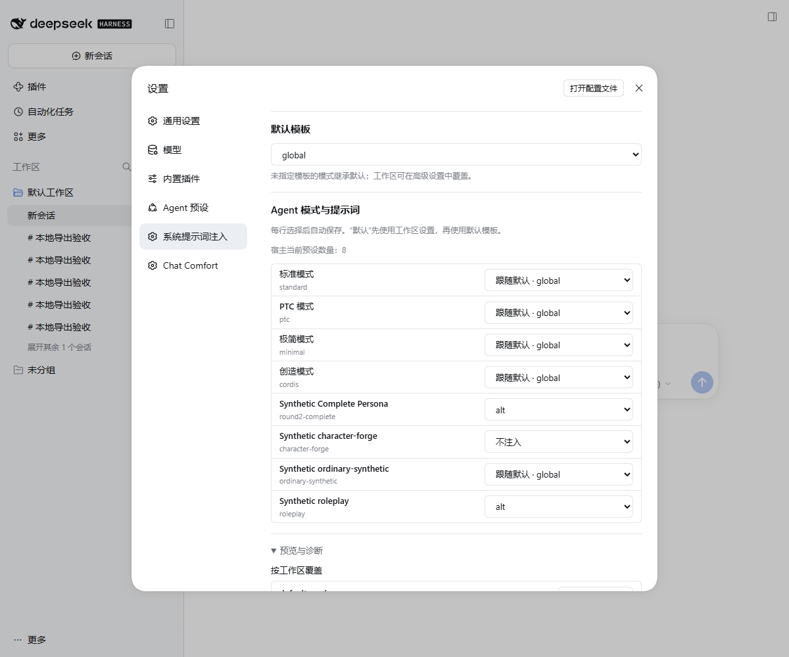
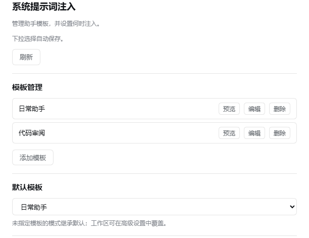
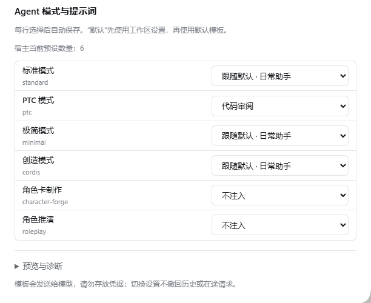

# 系统提示词注入 · DSH Prompt Inject

**Original Author:** [H1a3x](https://github.com/H1a3x)

**Current Maintainer:** [379385796-sys](https://github.com/379385796-sys)

[English](README.en.md) · [下载 v0.1.7](https://github.com/379385796-sys/dsh-prompt-inject/releases/tag/v0.1.7) · [兼容记录](docs/COMPATIBILITY.md)

管理命名 System Prompt 模板，为每种 Agent 模式直接选择跟随默认、不注入或指定模板，支持工作区覆盖、动态预设识别与自动保存。

这是 [H1a3x/dsh-prompt-inject](https://github.com/H1a3x/dsh-prompt-inject) 的维护适配版，保留原作者版权与 MIT 许可，**不是上游官方发行**。来源与修改见 [UPSTREAM](docs/UPSTREAM.md)。

**0.1.7 更新：** 兼容 DSH 0.2.2-rc.3；注入算法、模板选择与设置项均未改动，只扩展声明的宿主范围。详见 [CHANGELOG](CHANGELOG.md)。

## 模板如何生效

- 添加、编辑、删除和预览命名模板。
- 选择全局模板，或选择“不注入”。创建模板本身不会自动选中它。
- 每个工作区可以跟随全局、不注入，或使用指定模板；覆盖设置保留在折叠的高级区域。
- 每个 Agent 模式直接分配模板，模式名来自宿主注册信息和官方本地化；新增模式在打开设置或刷新后同步。
- 下拉选择自动保存，明确显示保存中、已保存及冲突错误。
- 使用宿主原生配置表单保存；冲突时保留草稿，刷新后重新检查并保存。

以下继承示例适用于模式选择“跟随默认”时；指定模板或“不注入”的模式选择优先。

| 全局选择 | 当前工作区选择 | 结果 |
| --- | --- | --- |
| 通用助手 | 跟随全局 | 使用“通用助手” |
| 通用助手 | 不注入 | 此工作区不追加模板 |
| 通用助手 | 代码审查 | 此工作区使用“代码审查” |
| 不注入 | 跟随全局 | 不追加模板 |

这些是选择规则示例，不是内置模板。宿主的 **complete persona** 可排除此插件的提示段；不能保证任意 Agent 预设都会注入。

## 安装

当前版本为 **0.1.7**。Node 要求 **24+**，声明的 DSH 范围为 `0.2.0-rc.2 || 0.2.1-rc.2 || 0.2.1-rc.3 || 0.2.1-rc.5 || 0.2.2-rc.1 || 0.2.2-rc.3`。当前目标为 Windows Desktop **0.2.2-rc.3**；`0.2.0-rc.2` 与 `0.2.1-rc.2` 是保留声明，不是本轮新验证。其他平台未验证。

1. 从 [v0.1.7 Release](https://github.com/379385796-sys/dsh-prompt-inject/releases/tag/v0.1.7) 下载 `dsh-prompt-inject-0.1.7.tgz` 与同名 `.sha256`。
2. 用 `Get-FileHash -Algorithm SHA256 -LiteralPath '<tgz完整路径>'` 核对校验值。
3. 通过 DSH 插件管理器安装本地 tgz，或使用已配置的 CLI：

   ```text
   dsh plugin --profile <你的Profile> add <tgz完整路径>
   ```

4. 重启后核对包名 `dsh-prompt-inject`、配置入口 ID `prompt-inject`、版本 `0.1.7`。

模板管理依赖宿主的 settings、systemPrompt、客户端设置表单、Cordis、Schemastery 和 React 接口；精确 peer 范围见 [package.json](package.json)。不依赖另外三款 DSH 插件，不应为绕过版本检查而手改宿主依赖。

## 第一次使用

1. 打开 **设置 → 系统提示词注入**，直接进入完整管理页面。
2. 点击“添加模板”，填写唯一名称与正文并保存。例如用“简洁回答”作为名称，正文写“回答时先给结论，再列必要依据。”
3. 在“全局默认模板”选择该模板；需要例外时，在“按工作区覆盖”中单独选择。
4. 展开高级区域的“预览与诊断”，选择工作区及 Agent Preset，检查预计模板、来源和正文。预览仅在本页生效，不保存选择、不发送模型请求，也不会猜测当前聊天目标。
5. 发起下一次模型请求。是否进入最终提示词，应以最终组装或请求为准，面板预览不等于已经注入。

模板以明文保存在 Profile 配置中，会进入模型请求与会话历史，fork 和备份也可能包含。请勿存放 API Key、密码或其他凭据。切换模板不会撤回已接受的请求、已有历史或压缩前缀。

## 常见问题

**创建并保存了模板，为什么没生效？** 检查全局选择与工作区覆盖，确认没有选“不注入”。保存只影响下一次组装；complete persona 会按宿主规则排除此段。

**为什么相似的工作区路径没有共用覆盖？** 匹配会去掉末尾分隔符并保留根路径语义，但不统一路径大小写或内部斜杠形式。请以面板列出的工作区路径为准。这不是权限隔离机制。

**删除选中的模板会怎样？** 使用它的全局选择会清空，显式工作区选择会变为“不注入”，不会意外改为跟随全局。

**保存冲突怎么办？** 保留草稿，刷新配置，检查最新状态后再保存；不要用旧页面反复覆盖。

**如何卸载？** 先备份自己需要的模板，再用插件管理器或 `dsh plugin --profile <你的Profile> remove dsh-prompt-inject`。卸载不撤回模型已收到的内容，也不保证删除保留配置或历史。

## 开发与界面资料

仓库直接分发 `lib/` JavaScript；`build` 检查共享解析器的浏览器副本与语法，不需要编译 UI。修改 `lib/selection.js` 后先运行 `node scripts/sync-client-resolver.mjs`，构建会拒绝不同步的副本。配置临时目录和工具缓存后运行：

```text
npm run check
```

该命令执行语法检查与现有合成回归，不访问个人 Profile。历史宿主验收见[兼容记录](docs/COMPATIBILITY.md)，版本变化见 [CHANGELOG](CHANGELOG.md)。

以下为 Windows DSH Desktop 0.2.2-rc.1 的实际 Web 设置页，使用隔离合成模板；不展示私人内容。预览显示预计解析结果，不代表最终请求已经注入。



历史 RC5 模板与模式页面（示例配置）：





许可见 [MIT](LICENSE)，作者与依赖说明见[第三方声明](THIRD_PARTY_NOTICES.md)及[上游记录](docs/UPSTREAM.md)。

## Agent 模式与提示词

设置 → 系统提示词注入：保留模板库，选择一份默认模板，然后在每种 Agent 模式右侧直接选择：

- **跟随默认 · 模板名称**：继承工作区覆盖；没有覆盖时使用默认模板。
- **不注入**：该模式不追加 Prompt Inject 模板。
- **具体模板**：使用库中指定模板，优先于工作区和默认模板。

每次下拉选择自动保存，界面明确显示保存中、已保存或错误。工作区覆盖和配置诊断在折叠区保留。指定模板被删除或失效时显示未解析并停止注入，不回退到其他模板。模板名称是现有不可编辑的唯一引用键，没有新增另一套模板 ID。

模式列表来自当前宿主注册项；使用官方内置本地化名称和第三方注册名，ID 为辅助信息。重新打开设置、重连或刷新会同步列表，并响应宿主预设设置更新通知。没有覆盖所有插件注册变化的可靠统一事件，因此不声称所有变更都会无条件即时推送。新增项默认继承；暂时消失的 ID 不显示为可用项，其映射仍保留，重新注册同 ID 后恢复。

旧候选的排除配置会安全迁移：旧开关开启时已排除项变为“不注入”，关闭时忽略旧名单。迁移是确定性的；下一次正常保存将映射与格式版本原子提交，冲突时不提交。模板正文、工作区覆盖及旧字段保留，已保存的新映射优先，不在启动时后台改写配置。

当前模式使用 RC5 的公开会话投影识别，不使用冻结的创建 header。有显式映射却无法确定当前 ID 时停止组装；全部继承默认时保留原选择逻辑。Complete Persona 仍按宿主规则成为唯一最终提示词。Prompt Inject 不加载 RP 总则、角色卡、世界书或记忆。切换设置不撤回历史、摘要或在途请求。

Windows x64 / DSH Desktop 0.2.2-rc.1 的实际验证范围见[兼容记录](docs/COMPATIBILITY.md)。
